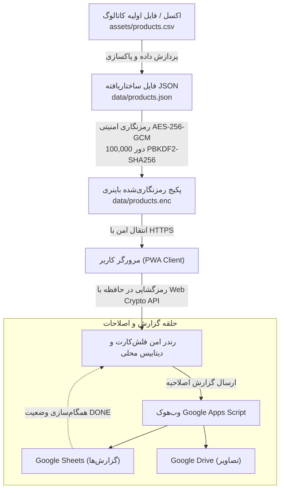

# سامانه جامع آموزش تعاملی و کاتالوگ هوشمند محصولات سولیکو کاله
### Solico TMR Learning & Interactive Product Catalog (PWA)

اپلیکیشن پیش‌رونده، مدرن و فوق‌سبک (PWA) برای آموزش، مرور ارگونومیک و تسلط کامل بازاریابان و نیروهای میدانی تجارت و فروش (**Trade Marketing Representatives - TMR**) بر بیش از **۱,۸۴۰ قلم کالای گروه سولیکو** (کاله، کاپو، سولیکو، سوربن، سلینو، ماجان، کاله پرو، لاکی‌دو، شمس و ...).

---

## 🎯 اهداف استراتژیک سامانه (Strategic Mission)

1. **تسلط آنی بر اطلاعات فنی و تجاری:** دسترسی ثانیه‌ای به شعارها، پیام‌های فروش، بازار هدف، ارزش غذایی، اصول چیدمان (پلانوگرام)، سناریوهای سمپلینگ و استدلال‌های مذاکره در برابر رقبا در کف فروشگاه.
2. **حلقه بازخورد زنده کاتالوگ (Crowdsourced Catalog QA):** مشارکت نیروهای میدانی در گزارش اصلاحات، توقف تولید، تغییرات اوزان یا ارسال تصاویر جدید با اتصال زنده به دیتابیس مرکزی.
3. **امنیت مطلق اطلاعات تجاری سازمانی:** محافظت از دیتابیس با رمزنگاری پیشرفته نظامی جهت جلوگیری از دسترسی و اسکرپ غیرمجاز اطلاعات توسط رقبا.
4. **کارکرد ۱۰۰٪ آفلاین:** عملکرد بدون وقفه در طبقات منفی هایپرمارکت‌ها و مناطق فاقد پوشش اینترنت.
5. **سربار سروری صفر برای سازمان:** معماری کاملاً استاتیک بدون نیاز به سرورهای گران‌قیمت یا نگهداری دیتابیس اختصاصی.

---

## ✨ قابلیت‌ها و ویژگی‌های کلیدی سامانه (Core Features)

### ۱. نمایش تعاملی دوگانه (Dual View Mode)
- **فلش‌کارت سه‌بعدی ارگونومیک (3D Card Carousel):** انیمیشن چرخش کارت با شتاب سخت‌افزاری (۶۰ فریم بر ثانیه):
  - **روی کارت (Front):** تصویر باکیفیت کالا، نام محصول، کد SKU، وزن و تعداد در کارتن، شعار تبلیغاتی، جملات کلیدی فروش (Claims) و بازار هدف (Targets).
  - **پشت کارت (Back):** پنل تب‌بندی‌شده فنی شامل نکات پرزنت فروشگاهی، سناریوی گام‌به‌گام سمپلینگ، اصول چیدمان و پلانوگرام شلف، جدول ارزش غذایی، ترکیبات کامل، تحلیل رقبا و اهرم‌های مذاکره قیمت.
- **نمای لیستی مدرن (Modern List View):** نمایش فشرده و کارآمد با عکس مربعی شاخص، اوزان، دسته‌بندی و دسترسی سریع به نشان کردن کالاها یا باز کردن مستقیم فلش‌کارت.

### ۲. سیستم پیشرفته ثبت اصلاحات و بازخورد کالا (Issue Reporting & Replacement Wizard)
- **جریان نظرسنجی ۲ مرحله‌ای (Step-by-Step Survey UX):**
  - **مرحله ۱:** انتخاب سریع سرفصل گزارش از طریق کارت‌های بصری (`اصلاح متن و محتوا`، `گروه کسب‌وکار یا دسته‌بندی`، `تصویر جدید`، `توقف تولید`، `پیشنهادات تکمیلی`).
  - **مرحله ۲:** فرم تکمیل هوشمند با نمایش مقادیر فعلی در برابر فیلدهای ویرایشی؛ فیلدهای چندسطری در جعبه‌های مجزا (`مورد ۱`، `مورد ۲`...) بدون نیاز به کاراکترهای جداکننده مبهم.
  - **مرحله ۳ (چرخه پیوسته نظرسنجی):** تایید ثبت گزارش همراه با کد پیگیری و پرسش *«آیا مورد دیگری برای همین کالا دارید؟»*.
- **بارگذاری و بهینه‌سازی کلاینت تصویر (Camera / Photo Upload):** فشرده‌سازی هوشمند عکس گرفته‌شده با دوربین موبایل در مرورگر با HTML5 Canvas (کیفیت JPEG 0.75 با ابعاد حداکثر 800px و حجم زیر ۱۵۰KB) بدون تحمیل بار به ترافیک پرسنل.
- **صف آفلاین (Offline Queueing):** در صورت قطع ارتباط اینترنت، گزارش‌ها در حافظه محلی ذخیره شده و به محض اتصال مجدد به صورت خودکار به سرور ارسال و سینک می‌شوند.

### ۳. اتصال ابری دوطرفه با Google Sheets و Google Drive (Two-Way Sync Webhook)
- **وب‌هوک سرورلس اختصاصی:** پردازش آنی درخواست‌ها در Google Apps Script بدون نیاز به سرور واسط.
- **آپلود مستقیم تصاویر به Google Drive:** ذخیره عکس‌های ارسالی پرسنل در پوشه اختصاصی گوگل درایو و درج لینک مستقیم و پیش‌نمایش در شیت.
- **همگام‌سازی وضعیت (Two-Way Sync):** امکان تغییر خودکار وضعیت گزارش‌ها از `PENDING` به **`DONE / REPAIRED`** (با هایلایت سبز) به محض اعمال اصلاحات در کاتالوگ مرکزی.

### ۴. تفکیک ۷ واحد تجاری و ۴۰ دسته‌بندی با تم رنگی پویا (Dynamic BU Theming)
- تفکیک جامع واحدهای سازمانی: **لبنیات، نوشیدنی، قنادی، کاپو، سلامت، بستنی، غذای آماده**.
- تغییر بلادرنگ پالت رنگی (رنگ اصلی، حاشیه‌ها، بج‌ها) متناسب با هویت بصری هر واحد تجاری.

### ۵. موتور جستجوی هوشمند لحظه‌ای (Instant Search Engine)
- فیلتر و جستجوی آنی در کسری از میلی‌ثانیه میان تمامی فیلدهای نام، SKU، شعار، ترکیبات و رقبای ۱,۸۴۲ کالا.

### ۶. سیستم نشان‌گذاری و علاقه‌مندی‌های پایدار (Persistent Favorites)
- ذخیره لیست علاقه‌مندی‌ها در `localStorage` و دسترسی فوری در فیلتر هدر.

---

## 🔒 امنیت نظامی و خط لوله داده‌ها (Enterprise Security & Data Pipeline)

برای جلوگیری از دسترسی مستقیم و استخراج لیست قیمت‌ها و فرمولاسیون توسط رقبا، سامانه از یک ساختار حفاظتی استاندارد صنعتی بهره می‌برد:



- **رمزنگاری در حالت سکون (Encryption at Rest):** داده‌های محصولات با کلید ۲۵۶ بیتی و الگوریتم **AES-256-GCM** به همراه تگ احراز اصالت ۱۶ بایتی محافظت می‌شوند.
- **تولید باینری کامپکت:** فایل نهایی `products.enc` حاوی Salt و IV تصادفی رمزشناختی است و بدون گذرواژه سیستمی روی مرورگرهای غریبه غیرقابل خواندن است.

---

## 📂 ساختار فایل‌های پروژه

```plaintext
MVP_Flashcard/
├── index.html                   # هسته تک‌صفحه‌ای (SPA)، مودال نظرسنجی و اسکلت PWA
├── manifest.json                # مانیفست استاندارد جهت نصب در اندروید، iOS و ویندوز
├── service-worker.js            # کنترل کش آفلاین (استراتژی Network-First برای داده‌ها)
├── assets/
│   ├── products.csv             # سورس اصلی دیتابیس کالاها (۲۱ ستون اطلاعاتی)
│   └── icons/                   # آیکون‌های وکتور سازمانی و نشان‌های PWA
├── css/
│   ├── app.css                  # سیستم طراحی، متغیرهای تم، انیمیشن‌های سه‌بعدی و مودال
│   └── fonts/                   # تایپوگرافی فارسی وزیرمتن (Vazirmatn) در اوزان مختلف
├── data/
│   ├── categories.json          # متادیتا و دسته‌بندی‌های ۷ واحد تجاری
│   ├── products.json            # داده‌های استانداردسازی‌شده موقت
│   └── products.enc             # پکیج نهایی باینری و رمزنگاری‌شده محصولات
├── js/
│   └── app.js                   # منطق برنامه، رمزگشایی Web Crypto، مودال نظرسنجی و وب‌هوک
├── google-apps-script/
│   ├── Code.gs                  # اسکریپت وب‌هوک گوگل شیت و ذخیره عکس در درایو
│   ├── README.md                # راهنمای گام‌به‌گام راه‌اندازی و دیپلوی وب‌هوک
│   └── seed_sample_reports.py   # اسکریپت تست و اعتبارسنجی گزارش‌ها
├── scripts/
│   └── mark_reports_done.py     # ابزار همگام‌سازی وضعیت گزارش‌ها (Two-Way Sync) به DONE
├── encrypt-products.js          # خط لوله تولید پکیج امنیتی باینری AES-256-GCM
├── Update-Products.ps1          # اسکریپت پاورشل تبدیل CSV به پکیج امنیتی
└── Run-App.bat                  # اسکریپت اجرای لوکال با سرور تست
```

---

## 💻 راهنمای راه‌اندازی و اجرا

### ۱. اجرای لوکال روی کامپیوتر توسعه‌دهنده:
کافی است روی فایل `Run-App.bat` کلیک کنید؛ یا در محیط ترمینال دستور زیر را اجرا فرمایید:
```powershell
python -m http.server 8080
```
سپس آدرس `http://localhost:8080` را در مرورگر باز کنید.

### ۲. استقرار سازمانی (Production Deployment):
این برنامه کاملاً **Static** است و به هیچ وب‌سرور یا ران‌تایم خاصی (مانند Node.js، PHP یا دیتابیس SQL) نیاز ندارد. تنها کافی است پوشه پروژه روی یک هاست استاتیک امن با پشتیبانی از پروتکل **HTTPS** (مانند IIS سازمانی، Nginx، یا GitHub Pages) قرار گیرد.

---

## 👥 تیم پروژه
- **طراحی و راهبری کسب‌وکار:** مرکز تعالی بازاریابی تجاری (CoE | Trade Marketing Department - Solico Kalleh)
- **پشتیبانی زیرساخت:** گروه فناوری اطلاعات و بازاریابی دیجیتال سولیکو
