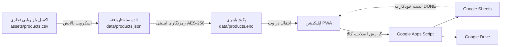

# گزارش فنی و معماری سامانه جامع آموزش تعاملی سولیکو کاله (TMR Learning & Catalog PWA)

**نسخه:** نسخه سازمانی آماده بهره‌برداری (Enterprise Production-Ready)  
**تاریخ به‌روزرسانی:** آذر ۱۴۰۵  
**مخاطب:** مدیریت ارشد، تیم فناوری اطلاعات (IT) و دپارتمان بازاریابی تجاری  
**هدف سند:** تشریح معماری، امنیت رمزشناختی، سیستم گزارش‌گیری زنده و الزامات استقرار سازمانی  

---

## ۱. معرفی و اهداف سامانه

سامانه آموزش تعاملی و کاتالوگ دیجیتال محصولات، یک **وب‌اپلیکیشن پیش‌رونده (Progressive Web App - PWA)** است که با هدف آموزش، تسلط آنی و افزایش کارایی عملیاتی بازاریابان میدانی (**Trade Marketing Representatives - TMR**) گروه سولیکو (کاله، کاپو، سوربن، ماجان، کاله پرو، سلینو و ...) توسعه یافته است.

این سامانه امکان دسترسی سریع و آفلاین به مشخصات فنی، جملات کلیدی فروش، سناریوهای سمپلینگ، اصول چیدمان شلف، ارزش تغذیه‌ای و استدلال‌های مذاکره بیش از **۱,۸۰۴ قلم کالای فعال سازمان** در ۷ واحد تجاری و ۴۶ دسته‌بندی تخصصی (با ۹ دسته مستقل برای واحد کاپو) را فراهم می‌آورد.

---

## ۲. مشخصات و پشته فناوری (Tech Stack)

| لایه سیستم | فناوری منتخب | دلیل انتخاب و مزیت معماری |
| :--- | :--- | :--- |
| **رابط کاربری (UI/UX)** | HTML5 + CSS3 مدرن | بدون فریم‌ورک‌های سنگین (Zero Runtime)، عملکرد ۶۰fps، استاندارد کامل RTL و فونت وزیرمتن |
| **منطق برنامه (Logic)** | Vanilla JavaScript (ES6+) | اجرای مستقیم روی موتور مرورگر با رم و سربار پردازشی نزدیک به صفر |
| **امنیت داده‌ها (Security)** | AES-256-GCM + PBKDF2 | رمزنگاری باینری در حالت سکون (`products.enc`) جهت ممانعت از اسکرپ اطلاعات توسط رقبا |
| **موتور رمزگشایی** | Web Crypto API | رمزگشایی در حافظه رم با شتاب سخت‌افزاری مرورگر |
| **یکپارچه‌سازی گزارش‌ها** | Google Apps Script Webhook | سیستم گزارش‌گیری دوطرفه بدون نیاز به دیتابیس یا سرور اختصاصی |
| **فضای ذخیره ابری تصاویر** | Google Drive API | آپلود خودکار عکس‌های ارسالی پرسنل به همراه فشرده‌سازی در سمت کلاینت |
| **کش و عملکرد آفلاین** | Service Worker + Cache API | امکان کارکرد ۱۰۰٪ آفلاین در فروشگاه‌های بدون آنتن و هایپرمارکت‌ها |
| **قابلیت نصب (Installable)** | Web App Manifest | نصب آسان به عنوان اپلیکیشن بومی روی اندروید، iOS و دسکتاپ |

---

## ۳. قابلیت‌های کلیدی و فرآیندهای جدید سامانه

### ۱. نمایش تعاملی دوگانه (Dual View Mode)
- **فلش‌کارت سه‌بعدی:** دارای دو روی کارت (روی کارت: اطلاعات فروش و بازار هدف؛ پشت کارت: مشخصات عملیاتی TMR، سمپلینگ، پلانوگرام، ارزش غذایی، ترکیبات و رقبا).
- **نمای لیستی مدرن:** برای پیمایش سریع و مقایسه اوزان و دسته‌بندی‌ها در جلسات فروش.

### ۲. سامانه هوشمند ثبت بازخورد و اصلاح کاتالوگ (Product Issue Reporting)
- **گردش کار نظرسنجی ۲ مرحله‌ای (Survey UX):** پرسنل به جای پر کردن فرم‌های طولانی، در مرحله اول نوع خطا (محتوا، دسته‌بندی، تصویر، توقف تولید، پیشنهاد) را مشخص و در مرحله دوم صرفاً فیلد اصلاحی را در جعبه‌های تفکیک‌شده پر می‌کنند.
- **فشرده‌سازی خودکار تصویر در کلاینت:** تبدیل عکس دوربین به فرمت JPEG با حجم زیر ۱۵۰KB روی HTML5 Canvas بدون مصرف ترافیک پرسنل.
- **صف آفلاین (Offline Queueing):** ذخیره گزارش‌ها در هنگام قطعی اینترنت و ارسال خودکار به محض آنلاین شدن.

### ۳. اتصال ابری دوطرفه (Two-Way Sync with Google Sheets)
- ثبت آنی گزارش‌ها در فایل مرکزی اکسل/گوگل‌شیت تیم مارکتینگ.
- **همگام‌سازی خودکار وضعیت:** پس از اعمال اصلاحات در سورس کد، سیستم با ارسال درخواست به وب‌هوک، وضعیت ردیف‌های مربوطه در گوگل شیت را به صورت خودکار به **`DONE / REPAIRED`** (با رنگ سبز) تغییر داده و یادداشت اقدام را درج می‌کند.

### ۴. امنیت پیشرفته داده‌های تجاری (Enterprise Data Security)
- به جای فایل‌های متنی خام JSON که به راحتی در مرورگر قابل کپی هستند، داده‌ها در قالب فایل باینری رمزنگاری‌شده `products.enc` منتقل می‌شوند.
- الگوریتم رمزشناختی: **AES-256-GCM** به همراه کلید مشتق‌شده از **PBKDF2 با الگوریتم HMAC-SHA256 و ۱۰۰,۰۰۰ دور محاسباتی**.
- عملیات رمزگشایی منحصراً در لحظه باز شدن قفل نرم‌افزار در حافظه موقت (RAM) انجام می‌شود و هیچ فایلی روی دیسک دستگاه ذخیره نخواهد شد.

---

## ۴. معماری خط لوله داده‌ها (Data Pipeline Flow)

---

## ۵. مزایای معماری برای تیم فناوری اطلاعات (IT) سازمان

1. **بار سرور نزدیک به صفر:** برنامه ۱۰۰٪ استاتیک است؛ هیچ فرآیند پردازشی سنگین، فراخوانی مداوم دیتابیس SQL یا سرورهای گران‌قیمت درگیر نخواهند بود.
2. **سطح حمله امنیتی صفر (Zero Server Attack Surface):** به دلیل فقدان بک‌اند سمت سرور و عدم اتصال مستقیم دیتابیس به اینترنت، هیچ نقطه نفوذی مانند SQL Injection یا Command Injection در زیرساخت سازمان وجود ندارد.
3. **عدم وابستگی به مخازن و کتابخانه‌های خارجی:** تمامی کدها، آیکون‌ها و فونت‌ها به صورت لوکال بارگذاری می‌شوند و در شرایط قطعی اینترنت بین‌الملل یا فیلترینگ دچار اختلال نمی‌شوند.
4. **چرخه نگهداری بدون هزینه:** به روزرسانی اطلاعات توسط تیم مارکتینگ صرفاً با بازتولید فایل `products.enc` انجام می‌شود و نیاز به توسعه‌دهنده مجزا ندارد.

---

## ۶. الزامات استقرار سازمانی (Production Deployment Requirements)

برای انتشار نسخه نهایی روی زیرساخت سازمان، صرفاً موارد زیر مورد نیاز است:
1. **فضای میزبانی فایل استاتیک (Static Web Hosting):** یک مسیر روی وب‌سرور داخلی (مانند IIS، Nginx یا Apache) یا هاست اختصاصی ابری.
2. **گواهی معتبر SSL/HTTPS (الزامی):** برای فعال شدن قابلیت نصب اپلیکیشن پیش‌رونده (PWA) و کارکرد Service Worker و Web Crypto API، ارائه برنامه روی بستر پروتکل HTTPS اجباری است.
3. **تنظیم MIME Types در وب‌سرور:**
   - `.enc` ➔ `application/octet-stream`
   - `.json` ➔ `application/json`
   - `.webp` ➔ `image/webp`
   - `.ttf` ➔ `font/ttf`
